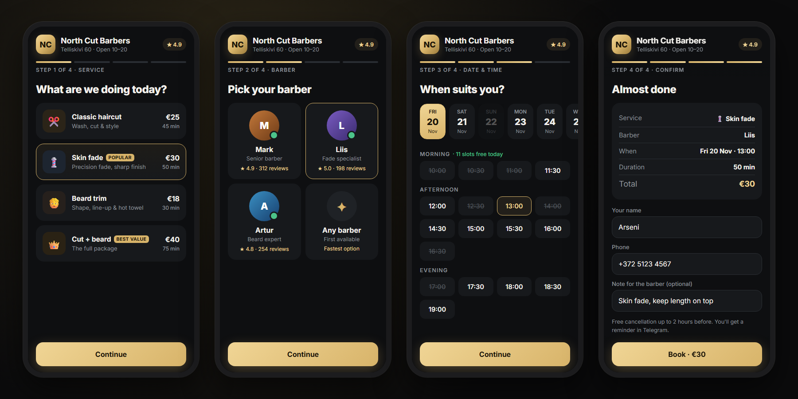

# Telegram booking bot with Mini App

A booking system for barbers, salons and other appointment businesses that runs inside Telegram.

Try it: [@arseni_devbot](https://t.me/arseni_devbot)



## What it does

**For customers**
- Books in an app-style screen inside Telegram: service, barber, date, time
- Sees live availability, taken slots are greyed out
- Gets a reminder 2 hours before
- Can see and cancel their bookings

**For the owner**
- Gets every booking in Telegram with Confirm / Decline buttons
- The customer is notified automatically
- `/today` and `/tomorrow` show the schedule and expected revenue

## Tech
- Python, python-telegram-bot 21, SQLite
- Mini App: plain HTML/CSS/JS with the Telegram WebApp API (theme, haptics, main button)
- Double bookings blocked in the database, reminders restored after restart
- Runs as a systemd service on a Raspberry Pi

## Run it
```
pip install "python-telegram-bot[job-queue]>=21,<22"
export BOT_TOKEN=...        # from @BotFather
export OWNER_CHAT_ID=...    # send /myid to the bot
export WEBAPP_URL=https://<you>.github.io/telegram-booking-demo/
python bot.py
```
The Mini App lives in `docs/` and is served by GitHub Pages.
